# Mini Claude: everything it does

An overview of every action, activity, mood and reaction. The pictures are drawn by the pet's own code. Setup, commands and game keys are in [README.md](README.md).

**How often** is shown for each state, Lively / Calm / Sleepy: *a lot*, *often*, *some*, *rare*, or – (never). The state changes by itself every 5 minutes. A new action is picked every 3–8 s when Lively, 5–11 s when Calm, and 8–18 s when Sleepy.

## Activities

Longer things it does with props. Most come with a line now and then, such as "Ctrl+S. Ctrl+S. Ctrl+S."

| Activity | Looks like | How long | Lively / Calm / Sleepy | Angles |
|---|---|---|---|---|
| **Laptop work** | 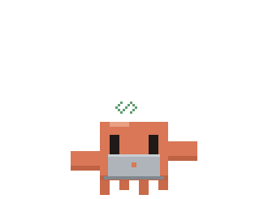 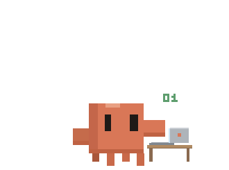 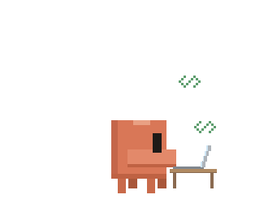 | 10–25 s | some / often / some | Whole scene. Front: the laptop on its lap. 45°: on a little desk beside it. Side: in profile, the lid tilted back. Little code symbols float up. |
| **Reading** | 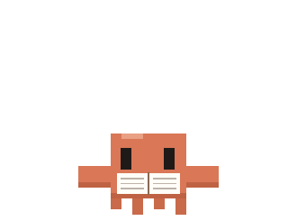 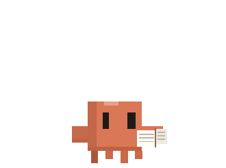 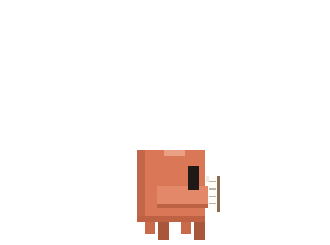 | 10–22 s | rare / often / some | Whole scene. Front: held up open. 45°: held out to the side. Side: edge-on in front of its face. Pages turn. |
| **Piano** | 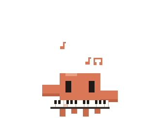 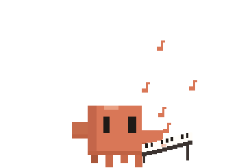 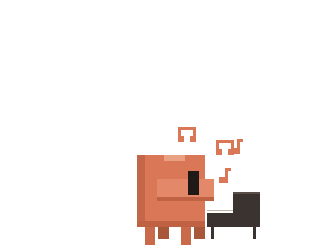 | 6–12 s | some / some / rare | Whole scene. Front: the keys in front of it. 45°: beside it, the keys running off to the back. Side: in profile with a music stand. Notes float up. |
| **Tea** | 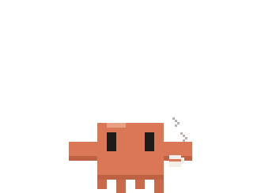 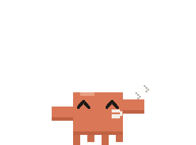 | 8–15 s | rare / some / often | Always facing you. Steam rises; now and then it takes a sip. |
| **Fishing** | 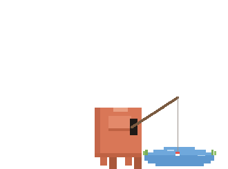 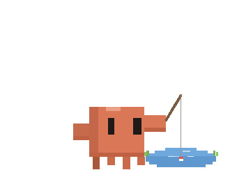 | 12–25 s | rare / some / some | Mostly in profile at a little pond (45° while floating). The water shimmers, the float bobs, ripples when something bites. At the end it announces its catch: "Caught: a semicolon!" |
| **Workout** | 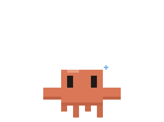 | 5–9 s | often / rare / – | Jumping jacks with sweat drops. Front or 45°. |
| **Stargazing** | 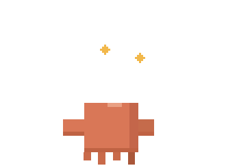 | 8–15 s | – / some / often | Often seen from behind, looking up. Stars twinkle around it. Three times as likely at night (23:00–6:00). |
| **Meditating** | 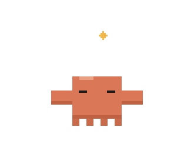 | 8–16 s | – / some / some | Eyes closed, floating up and down. Front or 45°. |
| **Selfie** | 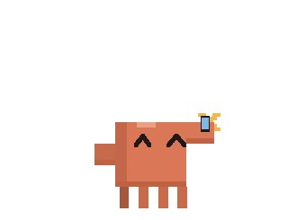 | 3 s | some / rare / – | Holds up a phone, smiles, flash. Often at 45°. |

## Little actions

Short things that fill the time between activities.

| Action | Looks like | How long | Lively / Calm / Sleepy | What happens |
|---|---|---|---|---|
| **Look around** | 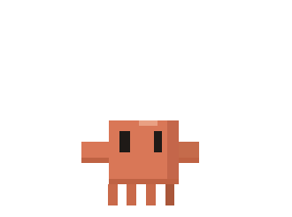 | 3 s | some / often / some | Turns its head left and right. |
| **Hum** | 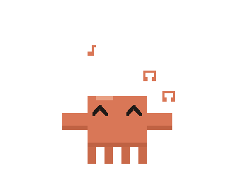 | 5 s | some / often / some | Sways with happy eyes, notes float up; half the time it hums a line. |
| **Stretch** | 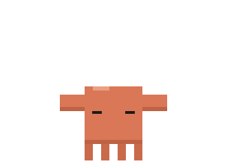 | 2 s | some / some / some | Arms up, eyes closed, a little taller. Sometimes "Mmmm~". |
| **Hop** | 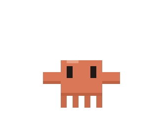 | 1.3 s | a lot / some / – | A small jump on the spot. |
| **Sit** | 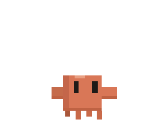 | 5–10 s | some / often / often | Sits down and kicks its legs. |
| **Yawn** | 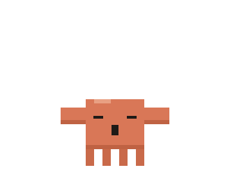 | 2 s | – / some / a lot | Mouth wide open. Twice as likely at night or when its energy is low. |
| **Turn around** | 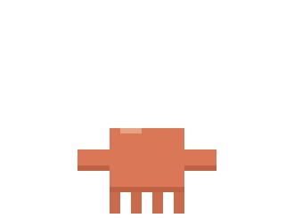 | 2.5 s | some / some / rare | Turns step by step to show its back, then turns back. |
| **A thought** | 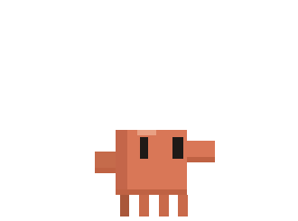 | 3 s | some / often / some | Looks up and says something it's been thinking about. |
| **Sneeze** | 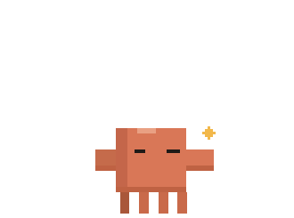 | 1.5 s | rare / rare / rare | Squints, turns away, "Achoo!", sparks. |
| **Wave** | 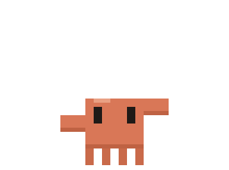 | 2 s | often / some / rare | Only when your cursor is near. Often says "Hi!". |
| **Dance** | 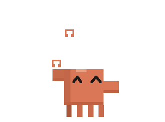 | 5 s | a lot / some / – | Bounces with its arms in the air and spins. Notes float up. |

## Moving around

| Move | Looks like | Lively / Calm / Sleepy | What happens |
|---|---|---|---|
| **Wander** (float mode) | 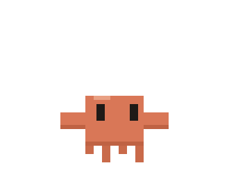 | a lot / a lot / some | Drifts somewhere new, then sometimes 1–4 more hops in a row. Stops now and then to look around. |
| **Follow the cursor** (float mode) | | often / some / – | Only when your cursor is near: "Wait for me!" |
| **Walk a ledge** (play on edges) | | a lot / often / some | Walks along the window top or line it stands on. |
| **Leap** (play on edges) | 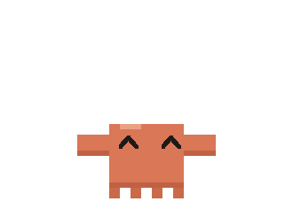 | a lot / some / rare | Jumps to another ledge it can reach. |
| **Climb** (play on edges) | | a lot / some / rare | Climbs a screen side, a window side or a vertical line in an app, hangs there, then climbs down or jumps off. |
| **Drop** (play on edges) | 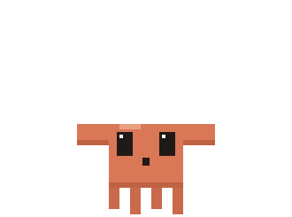 | some / some / rare | Walks to the end of its ledge and falls off. A fall of more than 300 px (at Normal size) makes it dizzy. |
| **Ride a window** (play on edges) | | always | Moves with a window when you move it, and falls when its edge is covered or closed. |

- Moving, climbing, falling and being dragged always use the front view.
- **Still or wander:** your choice in the menu. When no one is at the computer for 2 minutes, it switches between the two by itself; your choice returns when you're back.

## Moods

Moods come from Claude's replies (each reply starts with a mood tag) and from what you do.

| Mood | Looks like | When |
|---|---|---|
| **Happy** | 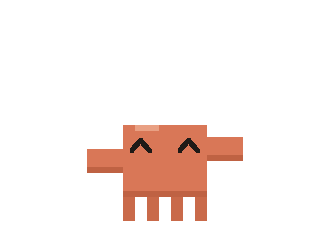 | A happy reply, a pet, a tickle, being dropped (sometimes). |
| **Excited** | 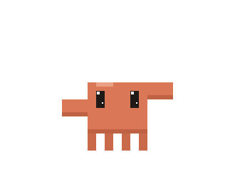 | An excited reply, turning Lively, spotting an app it knows. Big bounces. |
| **Love** | 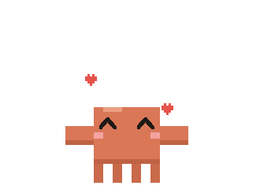 | A loving reply, every 50th pet. Hearts float up. |
| **Shy** | 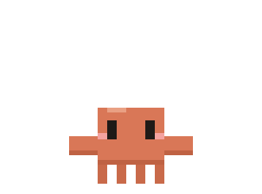 | Your cursor resting on it, a shy reply. Blushes and looks down. |
| **Surprised** | 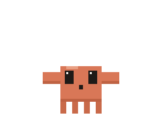 | Shaking the cursor fast near it, waking it with a click. |
| **Sad** | 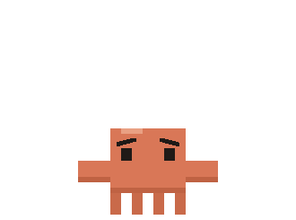 | A sad reply. Droopy arms. |
| **Sleepy** | 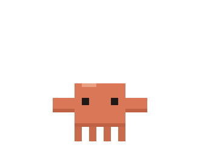 | A sleepy reply. Half-closed eyes. |
| **Dizzy** | 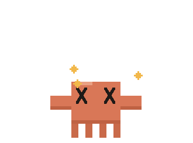 | After a long fall when playing on edges. Stars circle its head. |

The *think* and *calm* tags have no pose of their own: *think* makes it look up, *calm* keeps it as it is.

## Resting and thinking

| | Looks like | What happens |
|---|---|---|
| **Sleep** | 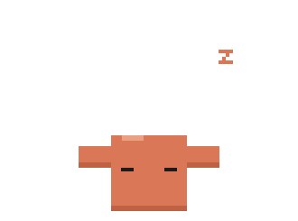 | Only when Sleepy and left alone for 90 s (or a 2–4 minute nap with `/sleep`). Z's float up. About every 2 minutes it half-wakes for a yawn, a stretch or a sip of tea. It wakes up when the state changes or when you click it. |
| **Waiting for Claude** | 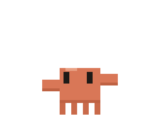 | While a reply is on its way, it looks around and its bubble shows a word like "Pondering…". |
| **Being dragged** | 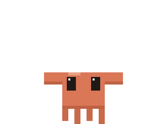 | Legs dangling, big eyes. After you let go it keeps its pose for a few seconds. Sometimes "Whee!". |

## Reactions to you

| You… | It… |
|---|---|
| Click it | Usually just blinks. Sometimes a heart (10%), a happy, shy or loving wiggle (12%), or a few words (8%). |
| Click it 5 times quickly | Half the time: "Hey! That tickles!" |
| Pet it for the 50th, 100th… time | Hearts, and it tells you the count. |
| Rest the cursor on it for 1.5 s | Gets shy: "You're staring (^_^)". |
| Shake the cursor fast near it | Gets surprised: "Whoa! Easy there!" |
| Leave the cursor still, then move it | Glances toward it: "hm?" |
| Move the cursor anywhere | Its eyes follow the cursor. |
| Double-click it | Opens the typing line. While you type, it watches and nods along. |
| Drag and drop it | Dangles; when floating it may cheer, when playing on edges it falls. |
| Open an app it knows | Comments on it once an hour (for example Cubase or Spotify). Only the window title is checked, on this computer. |
| Play game mode | Keeps its final pose between your moves; after 5 s without a key it goes back to doing its own things. |

## By itself, over time

- **States:** Lively, Calm and Sleepy, 5 minutes each in a random order (a 15-minute circle).
- **Float and play on edges:** they take turns, about 4 minutes each.
- **Talking:** a line every 1.5–3.3 minutes when Lively, 2–4.7 when Calm, 3.3–7.5 when Sleepy: things to say, thoughts, countdowns to coming dates, good morning, late-night reminders.
- **Greeting:** says hello when it starts, and notices how long you were away.
- **Small signs of life:** breathing while standing, blinking (sometimes twice), glancing to the side now and then, short pauses mid-walk.
- **Energy:** goes down while it's awake, faster at night, and back up while it sleeps. Low energy makes yawns and sleepy lines more likely.
- **Memory:** once a day, if its notes are over 2 days old, it asks big Claude to refresh them.
